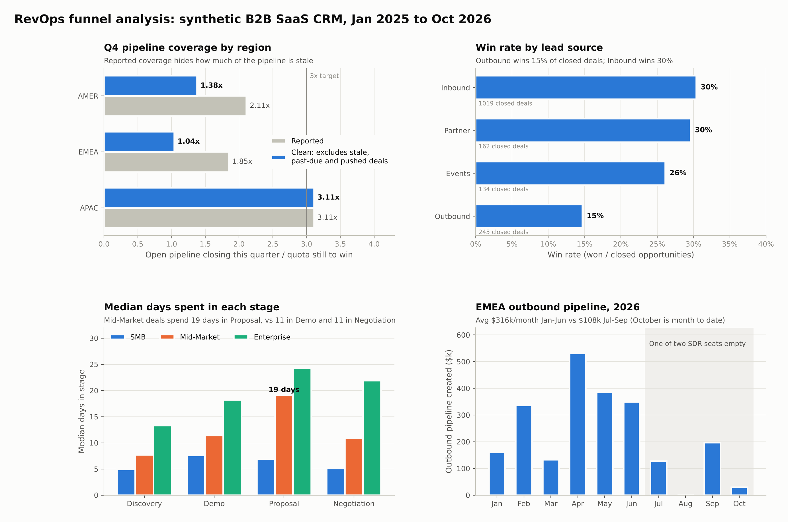
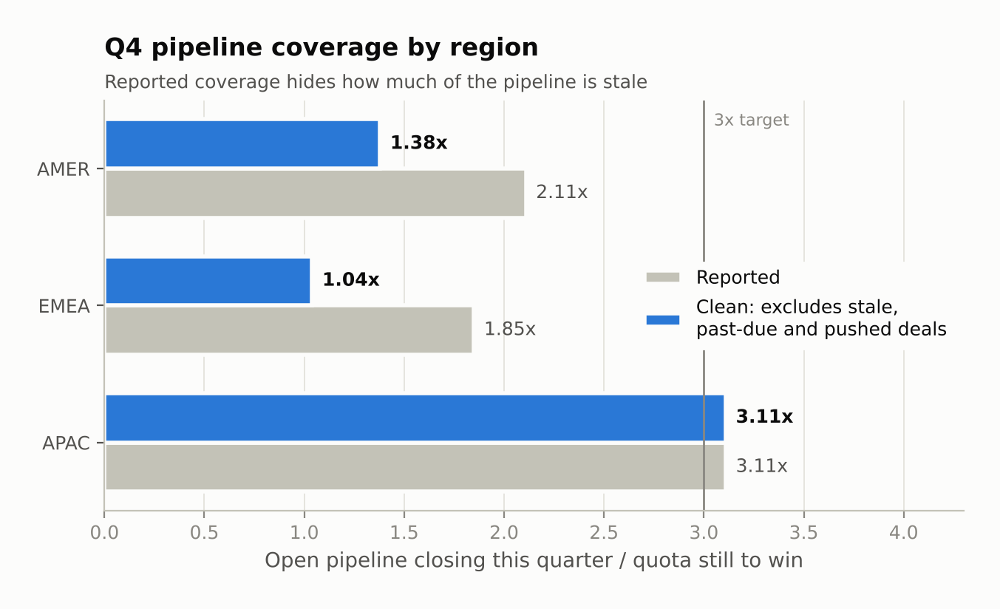
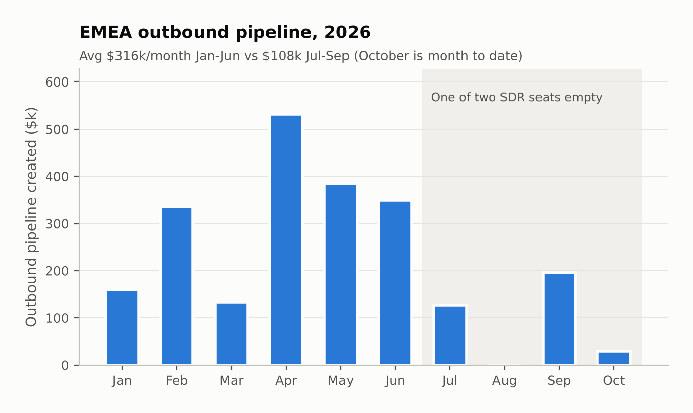
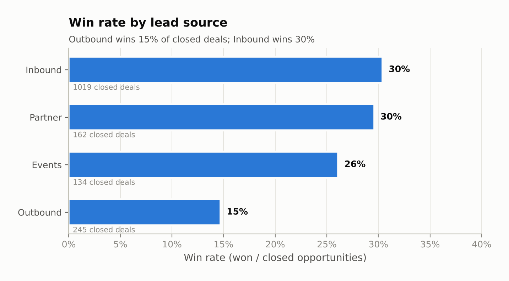
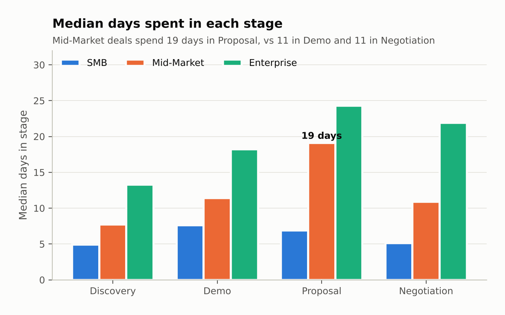
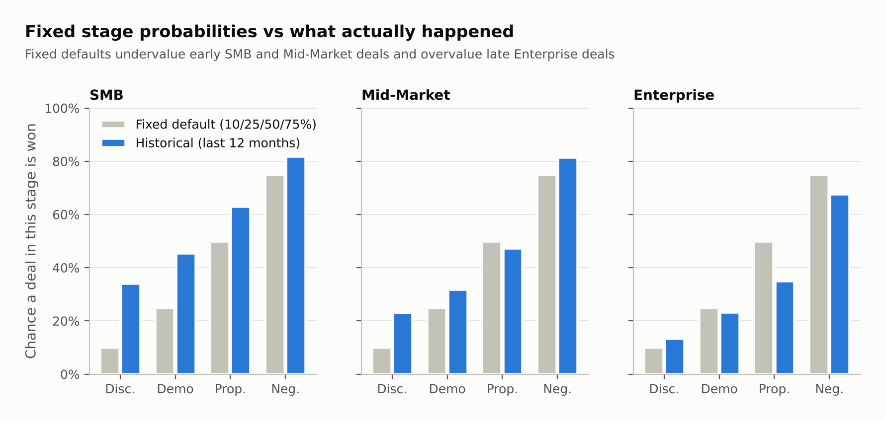
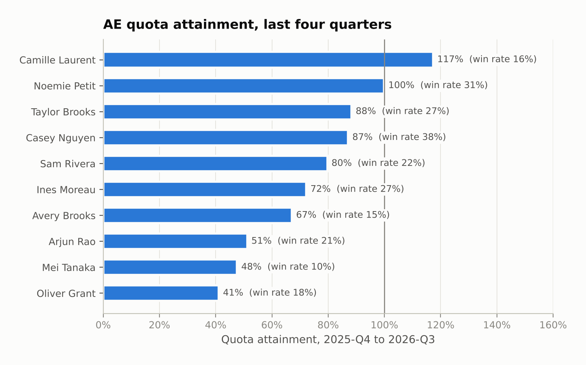

# RevOps Funnel Analysis

A full-funnel revenue operations analysis of a B2B SaaS CRM: lead-to-win conversion, stage drop-off, win rates, sales velocity, pipeline coverage, forecasting, rep performance and pipeline hygiene. It's written in SQL (DuckDB), cross-checked in pandas and summarised in charts and recommendations.

Built by Noah Coker. **All data is synthetic**: it's generated by a seeded simulation of a fictional company, so there's no real customer or employee data anywhere in this repo. The simulation deliberately includes realistic problems (a departed SDR, a struggling AE, a Mid-Market stall, stale pipeline) so the analysis has something to find. The point is the method for finding and sizing them, which works the same on a real CRM export.



## The questions

A CRO walking into a quarterly business review wants answers to five questions. Each one maps to a query in [`sql/`](sql):

| Question | Query |
|---|---|
| Where does the funnel leak, and which lead sources actually turn into revenue? | `01_funnel_by_quarter`, `02_funnel_by_source`, `04_win_rates` |
| Where do deals stall? | `03_stage_conversion`, `10_lost_reasons` |
| Will we hit the number this quarter and next? | `06_pipeline_coverage`, `07_forecast`, `07b_stage_win_probability` |
| How fast does pipeline turn into revenue, by segment? | `05_sales_velocity` |
| Which reps need help, and with what? | `08_rep_scorecard`, `09_pipeline_hygiene`, `11_outbound_trend` |

## What the analysis found

**1. Reported Q4 coverage looks thin, and the real picture is worse.** AMER shows 2.11x coverage and EMEA 1.85x, against a 3x rule of thumb. But 35% of AMER's and 44% of EMEA's Q4 pipeline is past due, hasn't moved stage in 30+ days, or has had its close date pushed at least twice. Without those deals, coverage is **1.38x in AMER and 1.04x in EMEA**. APAC's pipeline is clean at 3.11x.

**2. An empty SDR seat is showing up in EMEA pipeline.** One of EMEA's two SDRs left at the end of June and the seat wasn't filled. EMEA outbound pipeline fell from an average of **$316k a month (Jan-Jun) to $108k (Jul-Sep), down 66%**. Won EMEA outbound deals take a median of about 50 days to close, so the gap shows up in Q4 pipeline and continues each month the seat stays empty. AMER, with both SDR seats filled, held steady over the same months.

**3. Outbound wins half as often as inbound.** Outbound converts 15% of closed opportunities, against 30% for inbound and partner deals. Partner deals are also the largest (average won ACV $57k vs $22k inbound), so each partner lead is worth **$3,799 in won ACV, vs $472 for an outbound lead, about 8x**. Partner programs are under-invested at 7% of leads.

**4. Mid-Market deals stall in Proposal.** Mid-Market deals spend a median of **19 days in Proposal**, against 11 in Demo and 11 in Negotiation, and only 59% move forward from it, the weakest Mid-Market stage. Price and competitors are the top two reasons deals are lost at Proposal. Cutting the stall by eight days would raise Mid-Market sales velocity by about 16%.

**5. Fixed stage probabilities are wrong in both directions.** Many teams forecast with one fixed probability per stage, here 10% Discovery, 25% Demo, 50% Proposal and 75% Negotiation. Over the last 12 months, SMB deals in Discovery actually won 34% of the time, not 10%, while Enterprise deals in Proposal won 35%, not 50%. Weighting Q4 pipeline with segment-specific historical rates gives a forecast of **87% of quota in AMER and 76% in EMEA**.

**6. The weakest AE needs coaching, not more leads.** Oliver Grant reached **41% of quota** over the last four quarters, against 72% for Ines Moreau in the same pod with the same quota. His win rate is 18% (vs 27%), his deals sat a median of 25 days in Proposal over the same period (vs 18), and he carries more open deals than any other Mid-Market AE (31), with **77% of his open pipeline value stale, past due or pushed**. The pattern points to weak qualification and a cluttered pipeline.

## Recommendations

1. **Run a pipeline scrub before the Q4 forecast call.** Every past-due and stale deal gets a new close date with a next step, or is closed out. Report clean coverage next to reported coverage from now on.
2. **Backfill the EMEA SDR seat now**, and redirect some AMER SDR capacity to EMEA in the meantime to protect Q1.
3. **Shift lead budget towards partners.** Partner leads are worth roughly 8x outbound leads in won ACV.
4. **Attack the Mid-Market Proposal stall** with a mutual close plan at the Demo-to-Proposal handoff, and pricing guidance to cut the back-and-forth.
5. **Replace fixed stage probabilities** with the segment-level historical rates in `07b`, refreshed every quarter.
6. **Coach on qualification and hygiene for the lowest performer**, using the stage-level scorecard rather than attainment alone.

## Charts

| | |
|---|---|
|  |  |
|  |  |
|  |  |

## How the metrics are defined

| Metric | Definition |
|---|---|
| Win rate | Won ÷ closed (won + lost) opportunities. Open deals are excluded so recent cohorts aren't penalised. |
| Advance rate | Of the deals that left a stage, the share that moved forward rather than being lost. |
| Pipeline coverage | Open pipeline with a close date in the quarter ÷ quota still to win (quota minus won to date). |
| Clean coverage | The same, leaving out deals that are past due, unchanged for 30+ days, or pushed twice or more. |
| Historical stage probability | Of deals closed in the last 12 months that reached a stage, the share that were won. |
| Days in Proposal (scorecard) | Median days in the Proposal stage, for stage exits between 2025-Q4 and 2026-Q3. |
| Sales velocity | Opportunities per quarter × win rate × average won deal ÷ average sales cycle (days). It's used to compare segments and track the four levers, not as a revenue forecast. |
| Attainment | Won new-business ACV ÷ quota over 2025-Q4 to 2026-Q3. |

## Checking the numbers

Every headline metric is computed twice: once in SQL, and again independently in pandas by `scripts/verify_metrics.py`. **All 163 checks match.** They cover win rates, funnel conversion, won ACV per lead, stage advance rates, days in stage, sales velocity, reported and clean coverage, outbound pipeline by month, historical stage probabilities, both forecasts, lost-reason shares, and each AE's attainment, win rate, days in Proposal, open deals and at-risk share. On every push, GitHub Actions re-runs the SQL on the committed data, fails if any result changes, and re-runs the pandas checks.

## The dataset

`scripts/generate_data.py` simulates 22 months (January 2025 to 27 October 2026) of a fictional B2B SaaS company selling in three regions and three segments. It's seeded, so it produces the same data every run with the exact library versions pinned in requirements.txt. Funnel rates, stage durations and deal sizes vary by segment, source and rep. The simulation also includes the messy parts of real CRM data: deals that died but were never closed out, and close dates that keep getting pushed.

| Table | Rows | What it holds |
|---|---|---|
| `leads` | 10,710 | Source, segment, region, SDR, and when the lead became an MQL, an SQL and an opportunity |
| `opportunities` | 1,762 | Owner, amount (ACV), stage, close date, won/lost, lost reason, forecast category, close-date pushes |
| `opportunity_stage_history` | 5,904 | Every stage each deal entered and left, with timestamps |
| `accounts` | 9,132 | Company, industry, segment, employee band, region, country |
| `owners` | 15 | 10 AEs and 5 SDRs, with segment, region and start and end dates |
| `quotas` | 88 | Quarterly quota per AE, at half quota in an AE's first quarter |

The people and companies are invented. Quotas were calibrated so a typical AE lands near 95% of quota in expectation, checked across 24 random seeds, so differences in attainment come from performance and luck rather than from mis-set quotas.

## Run it

```bash
pip install -r requirements.txt
python scripts/generate_data.py     # writes data/*.csv
python scripts/run_analysis.py      # runs sql/*.sql in DuckDB, writes results/*.csv
python scripts/verify_metrics.py    # re-computes the metrics in pandas and compares
python scripts/make_charts.py       # writes charts/*.png
```

The SQL is written for DuckDB. [`docs/looker_studio_guide.md`](docs/looker_studio_guide.md) lists the changes needed to run it in BigQuery and walks through building the dashboard in Looker Studio.

## Repo layout

```
scripts/generate_data.py   seeded synthetic CRM generator
sql/                       12 analysis queries (00_load sets up tables and helpers)
scripts/run_analysis.py    runs the SQL with DuckDB, saves results/
scripts/verify_metrics.py  independent pandas cross-check (163 metrics)
scripts/make_charts.py     charts for this README
data/                      generated CSVs
results/                   query outputs
charts/                    PNG charts
docs/                      Looker Studio build guide
```
